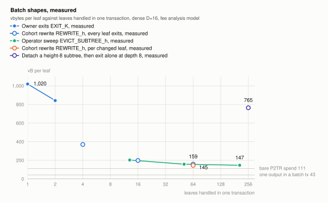
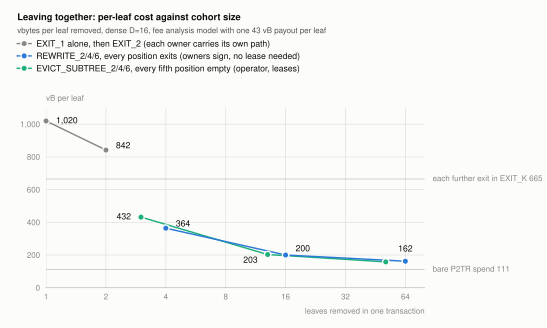

# Batching: sharing the path

*A design note on how LayerTree amortises the cost of a transition across
many leaves, what the spec already provides, and three shapes that
provide more. Two of the three, `REWRITE_h` and `DETACH_h`, are now built
(spec 7.9, 7.10, 8.9, 8.10) and the figures for them below are measured
by `tools/test_scripts.py --rewrite` and `test_detach`; the earlier
estimates they replace are kept in brackets where they were wrong. The
figures are the FULL tier's; `REWRITE_h` also exists in MID
(`tools/test_mid.py`, about 1.7 times the script and bounded by the
1,000-element stack limit at `h = 5` for a full cohort, spec 4.5) and
`DETACH_h` in CCV, both numerics (`tools/test_ccv.py`, 973 / 433 B at
`D = 16`, `h = 8`, the second `TREE_SPK` being one CCV call, spec 4.6).
Figures come from `tools/gen_cost_figures.py` and `spec/scripts/sizes.md`.*

Every transition proves one or more leaves against the committed root
and folds their replacements up to a new root. The proof is a path of
siblings, and the cost of the path is the cost of the transition: about
32 vbytes per level in the FULL tier, 16 levels at `D = 16`, so about 510
vbytes of a 1,020-vbyte exit is path. Batching is the question of how
many leaves can share one path.

## What a batch costs

A transition's cost has three parts, and the parts behave differently as
the batch grows.

| Part | What it is | Dense `D = 16`, FULL |
|---|---|---|
| Fixed | transaction skeleton, prologue (state binding, `TREE_SPK` twice), epilogue, control block | about 470 vbytes |
| Per shared level | one `LEVEL` macro and one 41-byte sibling | 32 vbytes |
| Per leaf | the 116-byte leaf, its signature, its payout output, and the per-position script that hashes it | about 100 to 120 vbytes |

The fixed part is paid once per transaction. The shared levels are paid
once per path, so leaves that sit under a common subtree share them. The
per-leaf part is paid for every leaf the transaction touches and is the
floor that no shape removes: a leaf that leaves must be published, must
authorise, and must be paid.

Two things follow. First, batching only helps leaves that share a path,
which in a dense tree means leaves in the same aligned subtree; two
random positions share only the few levels near the root. Second, the
operator's cohort grafts (`JOIN_h`) are what make batching possible
later, because they place a cohort in one subtree. A tree whose members
are placed by hash, as in the sparse profile, cannot batch at all.

## What exists

`EXIT_K` chains `K` independent single-leaf exits in one transaction.
Each carries its own full path, so the saving is only the skeleton: the
second leaf of an `EXIT_2` costs 665 vbytes against 1,020 alone.

`EVICT_SUBTREE_h` is the real batch. The witness carries the path above
an aligned subtree of height `h` once and then every position of the
subtree, as a leaf or an empty marker. The script folds the subtree in
post order from the published leaves, which both recomputes its root
and checks each leaf's lease and evictor key, then folds that root and
the empty node up the shared path. Measured at `D = 16`: 203 vbytes per
leaf for 13 leaves, 158 for 51, about 147 for 200. It is the operator's
tool and it requires a lease on every leaf it sweeps.

`JOIN_h` grafts a subtree of any size for the cost of the levels above
it, under 1 vbyte per member at a thousand members, because the covenant
checks only that the slot was empty and the sum is funded; it does not
look inside the subtree, which is why members verify their own path
before funding (9.2).

## Shape 1: the owner multiproof, `EXIT_SUBTREE_h`

Spec 13.4 names this and the sweep's generator already has its skeleton.
It is `EVICT_SUBTREE_h` with the authorisation changed: for each
position the witness supplies the leaf or an empty marker and a one-bit
flag, and for each flagged leaf a signature by its owner over the
transaction in place of the evictor-key check and lease test. Flagged
leaves are replaced by `E_0` in the new fold and paid in order to their
exit keys, exactly or with the FULL tier's fee option; unflagged leaves
pass through unchanged into the new root.

Rules, in the form of 7.7:

1. For every flagged position, `sig_i` MUST be a valid signature over
   `tx` by `leaf_i.owner_key`, and the next unused output from output 1
   MUST pay `leaf_i.amount` (exactly, under `EXIT^=`) to
   `P2TR(leaf_i.exit_key)`.
2. The old node is the subtree root recomputed from all supplied leaves;
   it MUST fold with the shared path to `(r, S)`.
3. The new node is the subtree root recomputed with every flagged leaf
   replaced by `E_0`. Output 0 is `(S − Σ flagged amounts, TREE_SPK(r', m))`.

One script per height covers every subset of owners in that subtree, so
the taptree carries a few heights, not a script per subset. This shape
was not built on its own: it is the exit-only case of `REWRITE_h` below
(every position's new element is `E_0`), and the measured figures are
that case's. At `D = 16`, with every position leaving, `REWRITE_2/4/6`
cost about 362, 198 and 161 vbytes per leaf [the estimates from the
sweep's sizes were 353, 222 and 177 at the sweep's occupancies]. Sixty
four owners who coordinate therefore pay what the operator pays to sweep
them (161 against 158), instead of 6.5 times.

The figure plots the cost per leaf removed against the number of leaves
removed in one transaction, for the three ways out at `D = 16`. Owners
who leave one by one pay 1,020 vbytes for `EXIT_1`, and batching them in
`EXIT_K` brings the average down to 842 at two exits and towards 665,
the marginal cost of each further exit, but never below it, because each
leaf still carries its whole path. The rewrite line starts below that
floor: `REWRITE_2` is 362 vbytes per leaf at four leaves. Fitting the
three rewrite points as a fixed part plus a per-leaf part gives about
860 vbytes fixed and 148 per leaf, so the rewrite line crosses the
`EXIT_K` marginal near two leaves and the single exit near one; every
height the taptree carries is cheaper per leaf than any `EXIT_K`. At
the same height the operator's sweep costs more per leaf than the
rewrite (432 against 362 at `h = 2`, 203 against 198 at `h = 4`),
because the measured sweeps leave three of every sixteen positions empty
and still publish them, so a sweep of a given height removes fewer
leaves. Plotted against leaves removed, the two lines cross near eight
leaves at about 270 vbytes per leaf: below that the rewrite is cheaper,
above it the sweep is a few vbytes cheaper per leaf for the same count,
and at `h = 6` the two nearly meet (158 against 161). Neither reaches a bare spend's 111:
the leaf's bytes, its signature, its payout output and its share of the
unrolled step stay.

The Lean model covers it as it stands: the shape is one `Step` whose old
node is a published subtree and whose new node is that subtree with
leaves removed, so `Steps.sum` gives conservation and `Steps.sound` gives
grounding, because the new subtree's preimage is in the witness.

## Shape 2: the cohort rewrite, `REWRITE_h`

Spec 13.5 describes a "replace subtree" transition authorised by one
MuSig2 aggregate of the cohort's keys and sets it aside because the
aggregate needs interactive nonce rounds. The per-leaf-signature form
needs no rounds and is the general cohort transition.

The witness carries the shared path, and for each position an old leaf
or empty marker and a new leaf or empty marker. For every position whose
new leaf differs from its old leaf, the owner of the old leaf signs the
transaction; the operator signs once for the whole transaction, as in
`UPDATE`. The old root is folded from the old leaves and the new root
from the new leaves. Output 0's amount is `S − Σ old + Σ new`, with any
increase funded by other inputs and any decrease free to spend, as in
7.4 rule 3. Under `UPDATE^x` the exit key of each changed leaf also
signs.

Within one such transaction a cohort can do everything the single-leaf
transitions do and several things they cannot:

- exits: a position goes from a leaf to `E_0` with a payout, as in
  Shape 1;
- joins into a cohort: a position goes from `E_0` to a leaf, funded;
- resizes, renewals and key rotations: `UPDATE` for many leaves at once;
- payments between members: one leaf's amount falls and another's rises,
  with the sum conserved. The payer signs; a rule that a leaf whose only
  change is an increase in amount need not sign makes the payee's
  signature unnecessary, and keeps the operator from rewriting a leaf's
  keys without consent.

The last item is the one that matters for the comparison with Ark. An
Ark round settles every member's new balance in one transaction, at the
price of every member being online to sign the round and of the tree
expiring. `REWRITE_h` settles a cohort's new balances in one transaction
with only the members whose balances fall signing, nothing expiring, and
unchanged members doing nothing. It is the on-chain settlement step of a
cohort that otherwise transacts off-chain by voucher or channel leaf.

Measured at `D = 16` (spec 11), a position of a 64-position rewrite
costs 244 bytes of script and 234 bytes of witness for its two leaf
copies, about 120 vbytes, whether or not it changes [the estimate was
57]; an owner signature adds 16 vbytes and an exit adds its 43-byte
output and drops the new leaf, so a changed leaf costs about 136 vbytes
and an exiting one about 150. Over a whole transaction a 64-leaf cohort
that rewrites every balance pays about 147 vbytes per leaf, against
1,073 for an `UPDATE` each [the estimate was 120], and one that leaves
together pays 161 per leaf, three more than the operator's sweep. The
unchanged position is more expensive than estimated because it is
published twice, as old and new element, and because its `REWRITE_STEP`
(the four-way branch, the amount-only test and two `ELEM_NODE`s) is
about 200 bytes of unrolled script where the sweep's `LEAF_STEP` is
about 150. The generator already hoists the `TAG_LEAF` prefix and `E_0`
out of the step (186 bytes per position saved); a one-byte "unchanged"
marker in place of the second leaf copy would save a further 29 vbytes
per unchanged position for about 2 of script, and is the next cut if
rewrites with few changes turn out to matter. A rewrite in which only a
few leaves change is still cheaper than the same number of `UPDATE`s
above about three leaves, but the unchanged leaves' bytes make it a tool
for cohorts that settle together.

Shape 1 is a special case of this shape once one rule is added: a
position whose old element is a leaf and whose new element is `E_0` MUST
pay the leaf's amount (exactly, or with the FULL tier's fee option) to
`P2TR(leaf.exit_key)` from the next unused output. With that rule the
rewrite is a safe mass exit, so the taptree carries one script per height
instead of two, and the owner's decision (2026-10-09) is to build
`REWRITE_h` with the exit rule and not a separate `EXIT_SUBTREE_h`. It
is built: spec 7.9 states the seven rules (the exit payout is exact, as
in the sweep), 8.9 gives the script, and the measured sizes at `D = 16`
are 2,775 / 5,512 / 17,148 bytes of script for `h = 2, 4, 6` with
1,643 / 4,329 / 15,139 bytes of witness on the mixed cohort of the test
suite (spec 0.11.0 added 11 bytes per position so that the amount-only
exemption of 7.9 rule 3 stops at a `SEQ_FINAL` leaf). The `^x` form adds
16 vbytes to every signed position.

The Lean argument is the same as for Shape 1: one `Step` with a published
old and new subtree, conservation from `Steps.sum` unconditionally,
grounding from the witness. The rewrite also closes the opacity caveat of
the design review (F18) for cohort joins: a graft whose leaves are
published is grounded by construction, where `JOIN_h` trusts the joiners
to have checked.

One detail of the built form is worth recording. The script decides from
the old and new elements whether a signature is due and rolls one up from
the witness only then, so the witness carries no placeholder for
positions that need none; a signature supplied where none is due is
consumed as the next position's old element and fails the fold. The
rule-3 exemption is checked as `new[8:] == old[8:]` and
`old.amount <= new.amount`, so every field but the amount is pinned
byte for byte.

## Shape 3: caching the shared path, `DETACH_h`

Shapes 1 and 2 share a path inside one transaction. Nothing in script can
refer to a previous transaction's witness, so the only place to cache
work across transactions is in what the output commits to. A tree output
commits to one root; to cache the upper levels of a cohort's path the
cohort needs an output of its own.

`DETACH_h` moves an aligned subtree into a new tree output. The witness
carries the path above the subtree and the subtree's root node. Rules:

1. The old node `(R_h, sum_h)` MUST fold with the path to `(r, S)`.
2. The new node is `E_h`. Output 0 is `(S − sum_h, TREE_SPK(r', m))`.
3. Output 1 is `(sum_h, TREE_SPK(R_h, m_h))`, where `m_h` is the taptree
   root of the parent's option set compiled for depth `h` (every variant
   the parent carries, less the heights that do not fit), fixed at tree
   creation as part of `m`; since spec 0.10.0 this is a rule, not a
   convention, so a cohort of channel leaves keeps its exact-payout exit
   when detached.
4. `sig` MUST be a valid signature over `tx` by `OPERATOR_KEY`.

After a detach the cohort is a LayerTree of depth `h` whose root is the
subtree root the members already hold proofs against: their existing
paths, truncated to the lower `h` levels, are their proofs in the new
tree. Every later exit from the cohort pays `h` levels instead of `D`,
and the `D − h` upper levels were proven exactly once, by the detach.
Measured at `D = 16` and `h = 8` (spec 7.10, 8.10, 11): the detach is
1,548 bytes of script and 497 of witness, about 780 vbytes [estimated
815], and each subsequent exit costs the depth-8 figure of 762 vbytes
instead of 1,020, so it pays for itself at the fourth exit [estimated
the third]; a cohort of 256 that all leave alone saves
about a quarter. The test suite shows a member's old path truncated to
its lower eight levels is the detached tree's own path and that an
`EXIT_1` from the detached tree succeeds with it.

The second effect is larger than the first. The detached cohort spends
its own output, so its exits form their own unconfirmed chain and the
25-transaction bound of 10.5 applies to it separately. Detaching is
sharding on demand, and it turns the single-UTXO throughput cap from a
property of the deployment into a lever the operator can pull when a
cohort's leaves become time-sensitive, for instance channel leaves whose
HTLC deadlines are near (C.9.5).

One consequence needs a rule, one that needed a rule no longer does,
and one that looked like a consequence is not. Vouchers used to bind
`m`, which `CLAIM` re-derives from the input it spends, so a voucher
against a leaf in a detached subtree had to be reissued under `m_h`.
Since spec 0.10.0 vouchers bind `tree_id` (6.2, 7.5), which the detached
tree inherits and whose `CLAIM` carries as a constant, so a voucher
issued in the parent redeems in the child as issued; the test suite
checks exactly that. And the detach spends nobody's balance, but it
changes everyone's exit path, so it is the operator's decision, like
`JOIN_h`; a per-cohort parameter chosen at graft time would be a format
change for no gain, since a detach can only shorten a member's path.

Channel leaves need nothing. `chan_id` (C.2.2) binds `m`, but as a
constant baked into the channel scripts of the leaf's `exit_key` at
creation, not as a value any script re-derives from the tree that is
spent. `DETACH_h` leaves every leaf's bytes unchanged, so an `EXIT_1` from
the detached tree creates the same `P2TR(exit_key)` funding output, the
same `UPD_F` script runs with the same `ctx_upd`, and every signed state
remains valid. The `m` in `chan_id` is therefore a creation-time domain
separator. It is also worth keeping. Without it, two channels that reuse
`(owner_key, nonce, P_chan, C, epoch)` across two trees would accept each
other's states, so a stale state from one could be presented against the
other; C.1.1 already forbids reusing `P_chan`, and `m` makes a violation
of that rule harmless instead of fatal. The replay it does not prevent is
harmless anyway: anyone can graft a byte-identical copy of a channel leaf
into another tree only by funding it, and the copy's states pay the
channel's two parties out of the grafter's money.

The Lean model has one tree output; `DETACH_h` conserves value across two,
`S = (S − sum_h) + sum_h`, so the model needs a two-output step or a
statement that the new output is a well-formed tree whose root is the
detached node. Both are small.

## The shapes together

| Shape | Who signs | Per-leaf cost at `D = 16` | Status |
|---|---|---|---|
| `EXIT_K` | each owner | 842 average at `K = 2` | measured |
| `EVICT_SUBTREE_h` | operator | 158 at 51 leaves | measured |
| `EXIT_SUBTREE_h` | each exiting owner | 161 at 64 leaves, as `REWRITE_6` with every position exiting | folded into `REWRITE_h` (13.4) |
| `REWRITE_h` | each changed owner, operator | 147 per changed leaf at 64 leaves (update); 120 per unchanged position | measured; spec 7.9; FULL and MID (MID: 224 per changed leaf at 32 leaves, 236 per exiting leaf) |
| `DETACH_h` then exits at depth `h` | operator, then each owner | 762 per exit after about 780 once | measured; spec 7.10; FULL and CCV (CCV: 621 once, 973 / 433 B) |

What the two new shapes have in common is that they reuse the existing
machinery: `REWRITE_h` is the post-order fold of `EVICT_SUBTREE_h` run
over two subtrees with a different per-position rule, and `DETACH_h` is
`JOIN_h` with the old and new node exchanged and one output check added.
Building them was the existing change checklist twice: generator and
stack comments, positive and negative cases, golden vectors, Go mirror,
spec sections 7 and 8, the tier matrix. The Lean model covers both
(`formal/LayerTree/Cohort.lean`): `rewrite_sound` and
`rewrite_exit_conservation` for the rewrite, `detach_sound` and
`detach_member_payable` for the detach, the latter stating the second
output directly rather than generalising `Step`. The one genuinely new mechanism is
the second tree output of `DETACH_h`, and it is the one with the largest
payoff, because it is the only change here that raises the exit
throughput of a deployment rather than lowering the bytes of an exit.
It is also the one CCV absorbs most cheaply: the second `TREE_SPK` is
235 bytes of EC arithmetic in FULL and a 45-byte `OP_CHECKCONTRACTVERIFY`
call in CCV, so the CCV detach is 973 bytes against FULL's 1,548.

What they do not change is the per-leaf floor. A leaf that leaves costs
its bytes, its signature and its output, about 100 vbytes, in every
shape, and a leaf that stays in a rewritten subtree costs about 120. The
remaining lever is the leaf itself: a leaf hash structured so that an
exit reveals only the exit key and amount plus a hash of the other
fields would cut the published bytes from 116 to about 72, which is
worth about 11 vbytes per leaf in every shape above. That is a format
change and belongs to a different page.
