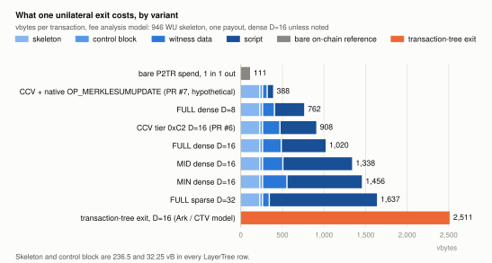
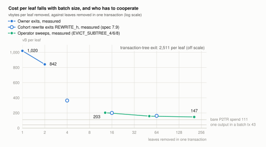
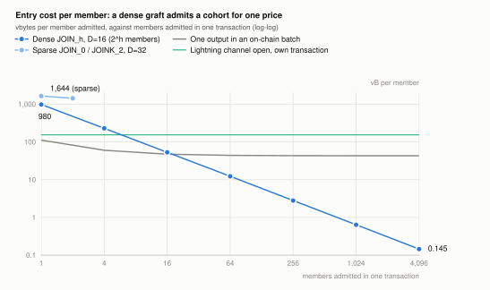
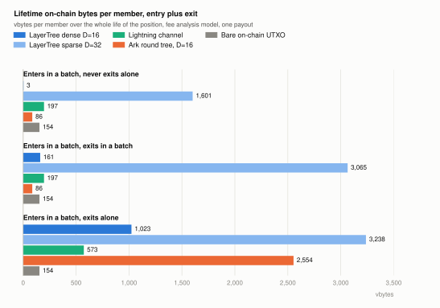

# Where LayerTree wins, and where it does not

*An informative cost comparison. Every number comes from the measured
size table in `spec/scripts/sizes.md` and the fee model in
`spec/fee-analysis.md`, or is derived from them as stated. Figures are
generated by `tools/gen_cost_figures.py`.*

The question a careful reader asks first is the right one: if joining,
updating and leaving a shared UTXO each cost more bytes than the same
operation on a bare UTXO, what does sharing buy? The short answer is that
LayerTree moves the cost of sharing out of steady state and into the exit.
Entering is close to free in bulk. Moving value is free, because it happens
off-chain. Leaving alone costs about ten times a bare spend, but it is one
transaction with no timelock, it needs nobody's cooperation, and it is 2.5
times cheaper than leaving a transaction tree of the same size. Leaving in
bulk costs about the same as a bare spend.

That combination is the design's claim against Ark-style round trees and channel
factories: the same shared UTXO, a cheaper and faster unilateral exit, no
expiry and no presigning. It is not a claim to beat a bare UTXO on every
operation, and the sections below say exactly where it loses.

## The unit of cost: one transaction, about 32 vbytes per level

Every LayerTree transition is one transaction that spends the tree output
and recreates it. The witness carries one leaf and its Merkle path, and
the script folds that path twice: once to check the old root, once to
compute the new one. Each level of the path costs 88 bytes of script and
41 bytes of witness in the FULL tier, which is about 32 vbytes. The tree's
depth `D` is fixed when the tree is created, so for a given tree the exit
is a constant size whatever the population. At `D = 16`, which holds
65,536 slots, a unilateral exit is 1,020 vbytes.



The figure breaks that 1,020 vbytes into its parts. The transaction
skeleton (fee input, change and the payout) is 237 vbytes and is the same
for every variant. The script is the largest part, because tapscript has
no loops and the 16 levels are unrolled. The MID and MIN tiers pay more
for the same work because they lack the restored arithmetic opcodes. The
CCV tier from PR #6 saves about a tenth by letting `OP_CHECKCONTRACTVERIFY`
do the state binding. The hypothetical native opcode measured in PR #7
brings the exit down to 388 vbytes, and that number is a floor for any
design that verifies a proof in-script: the proof itself is about 10
vbytes per level and still has to be published.

| Variant, dense `D = 16` unless noted | vbytes |
|---|---|
| Bare P2TR spend, one input and one output | 111 |
| One P2TR output inside a batch transaction | 43 |
| FULL tier | 1,020 |
| FULL tier, fee taken from the payout | 921 |
| FULL tier, `D = 8` and `D = 20` | 762 and 1,149 |
| FULL tier, sparse profile `D = 32` | 1,637 |
| MID tier | 1,355 |
| MIN tier | 1,473 |
| CCV tier, tapleaf `0xC2` (PR #6) | 908 |
| CCV plus native Merkle-sum opcode (PR #7, hypothetical) | 388 |
| Transaction-tree exit at `D = 16` (Ark or CTV model) | 2,511 |

The transaction-tree row uses the model of spec section 11: `D`
transactions of about 150 vbytes to unroll the branch, plus a final
claim. It flatters the tree, because it ignores the relative timelock at
the leaf and the fee each of the 16 transactions pays separately.

## Exits: what batching changes, and who has to cooperate

A single exit is the expensive case. The cost per leaf falls as more leaves
leave in one transaction, and how far it falls depends on who signs.



Owners who coordinate can leave together with `EXIT_K`. Each leaf still
carries its own full path, so the second leaf of an `EXIT_2` costs 665
vbytes and the average is 842. The operator can sweep an aligned subtree
of expired leaves with `EVICT_SUBTREE_h` for far less, because the sweep
publishes the subtree's leaves once and shares the path above it: 203
vbytes per leaf for 13 leaves, 158 for 51, and about 147 for the 200-odd
leaves of a height-8 subtree. The sweep is the cheapest removal in the
system and it is within a factor of 1.4 of a bare spend.

Two qualifications bound the sweep. First, it is the operator's tool, and it works only on leaves whose `evictor_key` is the
operator's and whose lease has expired. A lease is optional: a leaf that
sets `evictor_key` to the NUMS point can never be evicted, and a leaf with
a far-future `evict_after` cannot be evicted until then. One such leaf in a
subtree blocks the whole sweep (spec 7.7). So cheap bulk removal is
something members opt into at join time by accepting a lease, and the
figure of about 160 vbytes per leaf is not available to an owner who wants
out on their own schedule.

Second, the owner-side equivalent exists, and it is no longer the
expensive path. Spec 13.4 describes it: the same post-order fold that the sweep uses, with a
signature per leaf in place of the evictor-key check. The witness
carries the subtree's leaves, the exiting owners' signatures, and the
siblings of the shared path above the subtree, so leaves in the same
subtree share the levels above it. It is built as the exit-only case of
the cohort rewrite `REWRITE_h` (spec 7.9), and measured at `D = 16`:
four owners leaving a height-2 subtree pay about 364 vbytes per leaf,
sixteen leaving a height-4 subtree about 200, and sixty four leaving a
height-6 subtree about 162, within four vbytes of the operator's sweep.
`design/batching.md` has the shape and two more.

What a script fixes is the height and alignment of the subtree, not
which of its leaves exit. As in the sweep, the witness supplies every
position of the subtree, and a flag per position marks the leaves that
leave, so one script per height covers every subset of owners in that
subtree; owners in different subtrees need separate steps, as `EXIT_K`
does today. Each height is its own taptree leaf (design review F15), and
each doubling of the taptree costs every spend 8 vbytes, so which heights
to carry is a tree-creation choice; the reference taptree carries only
`K = 1` and `K = 2`; `REWRITE_2` is in the golden set as a tree-creation
variant.

Batching does not lift the serialisation limit, but it changes what the
limit counts. Every transition spends the same output, so unconfirmed
transitions form a chain, and default mempool policy caps that chain at 25
transactions until a block confirms it. The cap counts transactions, not
leaves: a sweep of 51 leaves is one transaction. Spec 10.5 states the
limit as about 25 exits per block because that is the worst case, where
strangers exit one at a time without coordinating. Block space is not the
constraint; 25 exits at `D = 16` are about 25 kvB. The structural answer
is to shard a deployment into several trees, each sized by exit throughput
rather than by depth.

## Entry: a graft admits a cohort for one price

`JOIN_h` grafts a prebuilt subtree of height `h` into an empty slot. The
script walks only the `D - h` levels above the slot, so a bigger cohort is
a cheaper transaction, and the covenant does not verify the subtree's contents.



At `D = 16` a four-member graft costs 915 vbytes, a 256-member graft 722,
and a 1,024-member graft 657. Per member that is under 1 vbyte at a
thousand members, against 43 vbytes for one output in an on-chain batch
and 154 for a channel open in its own transaction. The value grafted in
has to come from somewhere. The fee model's skeleton already counts one
fee input, so when the operator funds the graft from that input the whole
cohort costs nothing beyond the figure, and members buy their balances
off-chain with a hash-locked voucher paid over Lightning. When each member
funds their own leaf they each add an input of about 58 vbytes, and the
saving against an on-chain batch shrinks to the output side
(`design/graft.md`).

Two caveats bound the graft. Members must verify their own path inside the
subtree before funding, because a grafted node with no real tree behind
it freezes its value (spec 9.2, and the Lean model's grounding hypothesis).
And the sparse profile cannot graft at all. A sparse join is one leaf for
1,644 vbytes, because its position is a hash of the owner's key and the
script walks all 32 levels.

## Moving value: on-chain transitions are the wrong path

An on-chain `UPDATE` at `D = 16` costs 1,073 vbytes and a voucher
redemption with `CLAIM` costs 1,660, against 111 for a bare spend. If
members moved value by rewriting leaves on-chain, the shared UTXO would
cost ten times more per move than separate UTXOs. That comparison is the
one a sceptic makes, and on its own terms it is right.

The design's answer is that value moves off-chain, and the chain carries
only membership changes and the exercise of exit rights.

| 1,000 members each move value 1,000 times | On-chain bytes |
|---|---|
| Bare UTXOs, one spend per move | 111 MvB |
| LayerTree, one on-chain `UPDATE` per move | 1,073 MvB |
| Lightning channels: 1,000 opens, moves off-chain, 1,000 cooperative closes | about 300 kvB |
| Ark: 1,000 boardings in rounds, moves off-chain, periodic round transactions | about 90 kvB plus one round transaction per refresh |
| LayerTree: one 1,024-slot graft, moves off-chain in channel leaves or vouchers | about 1 kvB |

Three mechanisms carry the off-chain moves. A channel leaf hosts a
Lightning channel whose funding output does not exist until the leaf
exits, so payments between channel leaves are ordinary HTLC forwards and
touch nothing on-chain. A voucher is a signed instruction to carve a new
leaf out of the issuer's, redeemable with `CLAIM`; it is credit until
redeemed, and most vouchers are settled off-chain by the issuer rather
than redeemed. `SPLIT` (PR #10) is the same carve authorised by the
owner's own signature, for when the recipient is known. In all three,
nothing reaches the chain until someone chooses to exit.

What about moves that must touch the tree, such as resizing a cohort's
leaves or rotating keys? Today each is a single-leaf `UPDATE`. The
batched form is the subtree rewrite of spec 13.5: publish a subtree's
old leaves and new leaves, fold each once, and authorise with one
signature per leaf or one aggregate signature. Its per-leaf cost would be
close to the sweep's, roughly 100 vbytes, which is parity with a bare spend
in one transaction instead of many. It is built as `REWRITE_h` (spec
7.9): about 144 vbytes per changed leaf when all 64 positions of a
height-6 subtree rotate keys, against 1,073 for an `UPDATE` each. The
spec left the aggregate-key version out because MuSig2 nonce
coordination reintroduces the interactive rounds the design otherwise
avoids; the per-leaf-signature version has no such obstacle.

### What `UPDATE` is for, and how to make it cheaper

`UPDATE` is maintenance, not payment. It rewrites one leaf in place with
the owner's and the operator's signatures: resize a balance, renew a
lease, rotate a key, change the evictor. Sending value to another member
does not use it. A sender issues a voucher, which the recipient redeems
with `CLAIM` or, more often, never redeems because the operator settles
it off-chain; a sender who knows the recipient can use `SPLIT` (PR #10);
and channel leaves move value as HTLC forwards with no transition at all.

An `UPDATE` at `D = 16` is 1,073 vbytes because it carries one path, two
116-byte leaves, two signatures, and the same unrolled script as an exit.
Four things reduce it, in increasing order of change.

- The `OP_INTERNALKEY` fast path of spec 13.8 saves one `OP_TX` and one
  `TREE_SPK` evaluation, about 200 bytes, on the old-root check, with the
  binding caveat of 10.4.
- The `OP_MULTI OP_CAT` form of the level macro in 13.3 saves about a
  quarter of each level, roughly 350 bytes at `D = 16`.
- The CCV tier of PR #6 replaces the state binding and saves about a
  tenth; the native opcode of PR #7 removes the unrolled path and brings a
  single-leaf transition near 400 vbytes.
- The subtree rewrite of 13.5 publishes a subtree's old and new leaves and
  folds each once, so the per-leaf cost approaches the sweep's: the
  interior is paid once and each rewritten leaf adds its 116 bytes twice
  and a signature, about 138 vbytes. Leaves in the subtree that do not
  change need no signature; they are supplied once for the fold, with a
  one-byte marker in place of the second copy, or stand behind a sibling
  hash. This is `REWRITE_h` (spec 7.9), measured at about 148 vbytes per
  changed leaf and 92 per unchanged position at `h = 6`
  (`design/batching.md`).

The subtree rewrite is also a batch of intra-tree payments: moving an
amount from one leaf to another inside the rewritten subtree conserves
the sum, and only the leaves whose content changes must sign. That is the
on-chain settlement an Ark round performs, at about the cost of a bare
spend per touched leaf, without a round and without every member signing.

## The Lightning baseline

The Lightning figures on this page are those of the paper
(`paper/appendix-channels.tex`, `paper/full-cost.tex`): a simple taproot
channel priced with the same model as the LayerTree rows, fee-bumping
children included.

| Simple taproot channel | vbytes |
|---|---|
| Funding transaction: one P2TR key-path input, the funding output and change | 154 |
| Cooperative close: the MuSig2 key-path spend of the funding output | 154 |
| Commitment: a MuSig2 key-path input, two balance outputs and two anchors | 240 |
| Anchor child that pays the commitment's fee | 152 |
| Delayed sweep of the broadcaster's output after the CSV | 138 |
| Force close: commitment, anchor child and sweep | 530 |
| Lifetime, open in its own transaction and force close | 684, about 680 |
| Lifetime, open in its own transaction and cooperative close | 308 |
| Lifetime, open as one output of a batch and cooperative close | 197 |
| Lifetime, open as one output of a batch and force close | 573 |

The non-taproot anchor commitment of BOLT 3 is 1,124 weight units,
281 vbytes, in place of the 240 above. Against this baseline a LayerTree
member who leaves alone pays 1,020 vbytes for the first exit from a dense
`D = 16` tree (665 for each further exit in an `EXIT_K`), about twice a
channel's 530-vbyte force close and about 1.5 times its 684-vbyte
lifetime; a voucher redemption with `CLAIM` is 1,660. A channel leaf
inside the tree (Appendix C) costs its `EXIT_1` plus an update, a
settlement and their two anchor children, about 1,681 vbytes in all and
about 146 blocks, against 684 for a channel with its own funding output.

## Lifetime cost per member

The fair comparison adds entry and exit for one member and asks how the
member leaves.



| vbytes per member, enters in a batch | Never exits alone | Exits in a batch | Exits alone |
|---|---|---|---|
| LayerTree dense `D = 16` | 3 | 162 | 1,023 |
| LayerTree sparse `D = 32` | 1,644 | 3,108 | 3,281 |
| Lightning channel | 197 | 197 | 573 |
| Ark round tree `D = 16` | 86 | 86 | 2,554 |
| Bare on-chain UTXO | 154 | 154 | 154 |

The assumptions are simple and stated so they can be argued with. Entry
in a batch is one output in a shared transaction (43 vbytes) for
Lightning, Ark and the bare UTXO, and one share of a 256-slot graft for
LayerTree. A Lightning cooperative close is 154 vbytes and a force close
is 530: a 240-vbyte commitment, its 152-vbyte anchor child and a
138-vbyte sweep (the Lightning baseline above). Ark's cooperative exit
is one output in a round transaction and its unilateral exit is the
2,511-vbyte unroll. The bare UTXO is received once and spent once. The
LayerTree batch exit is the 51-leaf sweep, which requires a lease.

The table says where each design sits. LayerTree dense wins the first two
columns outright and loses the third to Lightning and to a bare UTXO,
while beating Ark there by 2.5 times. Members who hold a lease and let
the operator sweep them, or who sell their balance by voucher and never
exit, pay almost nothing. Members who insist on leaving alone pay for the
proof.

## Time and liveness

Bytes are half of the exit's cost. The other half is how long the exit
takes and who has to be online.

| | LayerTree exit | LayerTree channel leaf, force close | Lightning force close | Ark unilateral exit, `D = 16` |
|---|---|---|---|---|
| Transactions | 1 | 3, plus fee children | 3: commitment, anchor child, sweep | 16, plus the claim |
| Blocks until funds are spendable | 1 | about 146 | about 145 | 16 plus the leaf timelock |
| Timelock on the exit path | none | CSV on the settlement | CSV on the commitment | relative timelock at the leaf |
| Who must be online | nobody | a watchtower for stale states | a watchtower | the member, before the round expires |
| What expires | nothing; leases are optional | nothing | nothing | the round; funds must be refreshed |

The LayerTree row is the design's motivation in one line. There is no
presigned transaction to lose, no counterparty to wait for, no timelock,
and no expiry; the covenant checks a proof and pays. A channel leaf gives
up some of that in exchange for free payments, and its force close,
about 1,681 vbytes, is about three times a simple taproot channel's
530-vbyte force close, because materialising the funding output carries
the Merkle-sum proof (Appendix C.5).

## Dense or sparse

The sparse profile is a key-value store: a leaf's position is a hash of
its owner key and nonce, so nobody allocates slots, the root is the same
whatever order leaves arrived in, and a non-inclusion proof is an
inclusion proof of an empty node. The dense profile is an array: the
operator assigns slots, and a leaf's position is wherever it was put.

The sparse profile is not the cheaper one on-chain, and it is worth
saying why, because the intuition runs the other way. A dense proof does
not prove anything about its siblings. Each sibling is a 41-byte hash and
sum, empty or not, and the script hashes it either way. A sparse
proof elides empty siblings to one byte, so its witness is small: 326
bytes at `D = 32` against 902 bytes for dense at `D = 16`. But the script
dominates. Random positions need about twice the depth of allocated ones
to keep collisions rare, so the script unrolls 32 levels instead of 16,
and each sparse level costs 135 bytes instead of 88 because it must derive
the direction bit from the position and compute the empty node. The
witness saving of about 580 bytes does not cover the script cost of about
3,000.

| Dense `D = 16` versus sparse `D = 32`, FULL tier | Dense | Sparse |
|---|---|---|
| Script bytes per level | 88 | 135 |
| Witness bytes per level | 41 | 1 (empty) or 41 (occupied) |
| Levels | 16 | 32 |
| `EXIT_1` script and witness | 2,101 and 902 | 5,147 and 326 |
| `EXIT_1` vbytes | 1,020 | 1,637 |
| Single join | 980 | 1,644 |
| Cohort graft | yes, `JOIN_h` | no |
| Cohort sweep | yes, `EVICT_SUBTREE_h` | no |
| Slot allocation | operator | none, derived from the key |
| Root depends on insertion order | yes | no |

So the sparse profile buys properties, not bytes: no operator in the
position assignment, history independence, and a proof that a key is
absent. A deployment that needs those pays 1.6 times the dense exit and
gives up grafts and sweeps.

Raising the radix shortens the walk but widens each step. With radix `r`
the path has `D / log2(r)` levels and each level carries `r - 1`
siblings, so total sibling bytes grow from `40 D` at radix 2 to `60 D` at
radix 4 and `150 D` at radix 16. Radix 2 is the minimum for witness bytes.
What a higher radix can save is the fixed per-level script cost, and that
is where the two profiles differ. In the dense profile the level macro is
88 bytes of script against 41 of witness, so halving the levels at radix 4
roughly trades 2,064 bytes for an estimated 1,700 to 2,200, which is at
best a fifth saved. In the sparse profile the siblings are mostly empty
and the script is almost all of the cost, so radix 16 would cut the 32
unrolled levels to 8 at perhaps 300 bytes each, an estimated 2,500 bytes
against 5,147. None of this is measured; spec 13.2 lists it as an
extension. With a native opcode the per-level cost is only the sibling,
and radix 2 is optimal.

## Where LayerTree loses

- A solo exit is 1,020 vbytes against 111 for a bare spend and 530 for a
  Lightning force close with its anchor child and sweep. The proof is the
  price of the shared output.
- An on-chain per-leaf update is 1,073 vbytes. Moves must be off-chain or
  batched; the batched rewrite `REWRITE_h` brings a cohort's update to
  about 144 vbytes per changed leaf.
- The sparse profile costs 1.6 to 2.7 times the dense one and cannot graft
  or sweep.
- Uncoordinated exits serialise through one output at about 25
  transactions per block, which bounds how many time-sensitive leaves one
  tree should host.
- The opcode set is larger than CTV's: restored arithmetic, `OP_TX`,
  `OP_CHECKSIGFROMSTACK` and the EC ops in FULL, or `OP_CAT` plus
  `OP_TWEAKADD` in MIN. None is active today.
- The MID tier caps each tree at 2^31 satoshis, about 21.47 BTC.
- Fee pinning on the shared output is outside the model.

## How the numbers are made

A transaction's weight is the script, witness data and control block from
`spec/scripts/sizes.md` plus a 946-weight-unit skeleton: one fee input,
one change output, the tree output and one P2TR payout. Each extra payout
adds 172 weight units. Vbytes are weight divided by four, rounded up. The
sweep rows use the leaf counts the measured witnesses imply (13, 51 and
206). The cohort rewrite rows are the measured `REWRITE_h` sizes of
spec 11. The CCV and native-opcode rows come from the size tables of
spec 4.5 and `design/native-opcodes.md`.

The model leaves out the witness serialisation overhead: the item count
and one length prefix per witness item. `tools/measure_weight.py`
serialises the real transactions the test suites build and measures it
(`spec/scripts/weights.md`): 10.5 vbytes on a FULL `EXIT_1` at `D = 16`
(1,030 against the model's 1,020), 10 in the CCV tier, and about 43 and
45 in the MID and MIN tiers, whose witnesses carry each level's sibling
as several small elements.

```
python3 tools/gen_cost_figures.py    # regenerates design/figures/*.svg
python3 tools/measure_weight.py      # regenerates spec/scripts/weights.md
```
