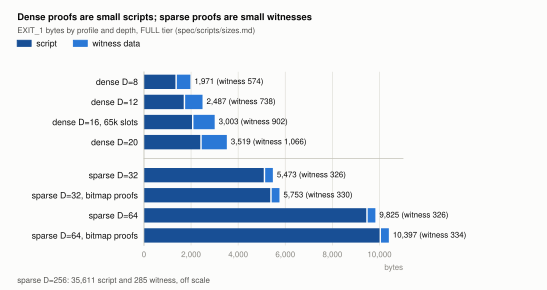
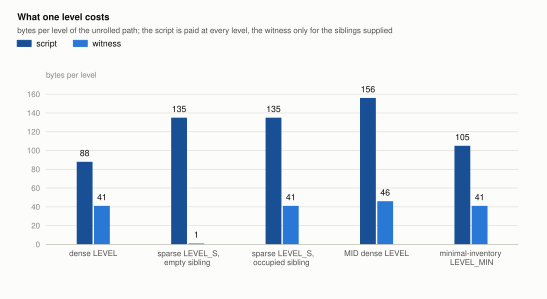
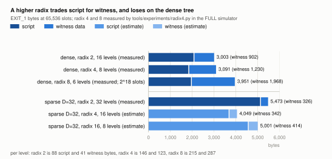

# Dense or sparse: two profiles of one sum tree

*An informative comparison of the two tree profiles in spec sections 5.4
and 5.5, with the measured costs from `spec/scripts/sizes.md` and an
analysis of what a higher radix would change. Figures are generated by
`tools/gen_cost_figures.py`.*

Both profiles are the same Merkle-sum tree. The difference is who decides
where a leaf sits, and that one choice sets the depth, the proof encoding,
which transitions exist, and the price of every exit. The dense profile is
the cheaper one on-chain by a factor of 1.6 to 2.7. The sparse profile is
the one to choose when positions must follow from keys rather than from an
allocator, and the rest of this page is about what that costs and why.

## One tree, one node format

A node in either profile is a pair `(hash, sum)`. A branch hashes its two
children as

```
H_node( left.hash || enc64(left.sum) || right.hash || enc64(right.sum) )
```

with `sum = left.sum + right.sum`, and a leaf is the 116-byte record of
spec 5.2 hashed under its own tag. The empty leaf is `E_0 = (0x00 * 32, 0)`
and the empty subtree of height `k` is `E_k`, the parent of two `E_{k-1}`.
Every verifier recomputes the sums; nothing trusts a sum it did not derive.

That branch preimage binds each child's sum on its own, not only the
total. The distinction matters because the Taproot Assets MS-SMT hashed
`left.hash || right.hash || (left.sum + right.sum)`, and a tree built that
way admits inflation: two leaves of 100 can share a root whose sum is 100,
each with an inclusion proof whose sibling claims a sum of zero, so the two
proofs together "prove" 200 against a root that holds 100
(lightninglabs/taproot-assets-private#112). In LayerTree the two proofs
would hash the preimages `(A, 100, B, 0)` and `(A, 0, B, 100)`, which are
different, so at most one of them can reach the root. The Lean model
states this directly: `serializeNode_inj` proves the 82-byte preimage is
injective in all four fields, `hNode_inj` assumes the hash is injective on
it, and `fold_sound` concludes that a leaf verified against the root is
the leaf at that position with its true amount. The FULL-tier suite's
"forged leaf", "stale root" and "unconserved amount" cases exercise the
script side of the same fact.

## What the profiles decide

| | Dense | Sparse |
|---|---|---|
| Position of a leaf | assigned by the operator | `H_pos(owner_key ‖ le32(nonce)) mod 2^D` |
| Depth for 65,536 members | 16 | 32 (64 for a global tree) |
| Root depends on insertion order | yes | no |
| Non-inclusion proof | no | yes, an inclusion proof of `E_0` |
| Uniqueness of `(owner_key, nonce)` | by the operator's bookkeeping | structural |
| Cohort graft `JOIN_h` | yes | no, single-leaf joins only |
| Cohort sweep `EVICT_SUBTREE_h` | yes | no |
| Proof encoding | a direction bit and a 41-byte sibling per level | sibling only; empty siblings elided to one byte |
| MID tier depth limit | none below 24 | `D <= 31`, nonce ground so `pos_lo` is a minimal positive number |

A sparse leaf's position is a function of the leaf, so a joiner computes it
alone, two leaves with the same key and nonce cannot both exist, and the
root is a function of the leaf set and nothing else. Those are the
properties of a key-value store. The dense profile has none of them and
does not need them for its own transitions: an exit proves inclusion, and
a join proves that the target slot is `E_h`, which both profiles do the
same way.

## Where the bytes go

A sparse proof is the smaller witness and the larger script, and the
script wins.



At `D = 16` a dense `EXIT_1` is 2,101 bytes of script and 902 of witness.
The sparse `EXIT_1` at `D = 32` is 5,147 bytes of script and 326 of
witness, measured on a six-leaf tree; each further occupied sibling adds
41 bytes, and a tree of `N` leaves has about `log2 N` of them, so the same
exit at 65,536 members carries about 860 witness bytes. The witness saving
is real but it is worth at most 600 bytes, and the script costs 3,000
more. In vbytes the dense exit is 1,020 and the sparse one is 1,637 on
the six-leaf measurement and about 1,800 at 65,536 members.



Two things make the sparse script larger, and both follow from letting
the position be a hash.

**Twice the levels.** A dense tree holds `2^D` members in `D` levels
because the operator fills slots in order. Sparse positions are random, so
two members collide with probability about `N^2 / 2^(D+1)`; at 65,536
members that is one expected collision at `D = 32` and about 32,000 at
`D = 16`. A collision is resolved by regrinding the nonce, which is cheap
when collisions are rare and useless when they are common, so the sparse
tree needs about twice the depth for the same population. Tapscript has
no loops, so every level is unrolled in the script and paid on every
spend.

**A heavier level.** The dense `LEVEL` macro is 88 bytes: check the
sibling's size, split off its sum, add it to both running sums, order the
pair by the witness's direction bit, and hash. The sparse `LEVEL_S` is 135
bytes because it does three more things. It derives the direction bit from
the position with a shift and a mask instead of reading it from the
witness. It tests whether the supplied sibling is empty and, if so,
substitutes the empty node of that level. And it advances the empty node
to the next level by hashing it with itself, because `E_{k+1}` is needed
at the next level and the script cannot carry 32 constants. Those 47
bytes, over twice as many levels, are the whole difference.

| `EXIT_1`, FULL tier | Dense `D = 16` | Sparse `D = 32` | Sparse `D = 64` |
|---|---|---|---|
| Script bytes | 2,101 | 5,147 | 9,499 |
| Witness bytes (six leaves) | 902 | 326 | 326 |
| Witness bytes (65,536 leaves) | 902 | about 860 | about 860 |
| Transaction vbytes (six leaves) | 1,020 | 1,637 | 2,725 |
| Transaction vbytes (65,536 leaves) | 1,020 | about 1,800 | about 2,890 |

The bitmap encoding of the MS-SMT BIP, in which the witness carries a
bitmap of empty levels and only the non-empty siblings, saves 28 witness
bytes at `D = 32` and costs 276 bytes of script, because each level must
extract a bit and conditionally roll a witness element. It is the right
wire format between operator and member and the wrong one on-chain, and
the reference implementation keeps it only so the comparison is measured
(spec 5.5).

## What the depth buys and costs

The sparse profile does not need to be as deep as 256. A full-width
MS-SMT keyed by the raw hash costs 35,611 bytes of script per exit, about
twelve times the dense figure, and buys only the ability to use a key
directly as a position. Truncating the position to 32 or 64 bits keeps
every property above, with collisions handled by the nonce, at a fifth of
the script. The recommended range is 32 to 64 (spec 5.4).

Depth also sets the MID tier's limit. MID numerics are four-byte
`CScriptNum`, and the sparse level derives the direction bit from the low
bits of the position with a shift. The position must therefore arrive as a
minimal positive number of at most 31 bits, which caps `D` at 31 in MID
and obliges the joiner to grind a nonce until the low bits qualify
(CLAUDE.md gotchas, `tools/layertree_mid.py`). The dense profile reads its
direction bits from the witness and has no such limit.

## Choosing

Choose dense unless positions must follow from keys. Dense is 1.6 to 2.7
times cheaper per exit, it grafts a cohort of any size for one price, and
it sweeps a cohort of expired leaves for about 160 vbytes per leaf. Its
price is an allocator: the operator assigns slots and keeps the map, and
a member who loses their path depends on the operator or their own backup
to recover it (spec 10.9), which is true in the sparse profile as well.

Choose sparse when the tree is a registry: when a leaf must be findable
from its key by anyone, when the root must be the same whoever built it,
or when absence must be provable. A sparse tree still hosts channel
leaves and vouchers, and it still exits in one transaction; it gives up
grafts and sweeps, and every member pays the deeper, heavier path.

The design review (F14) notes a hybrid, dense subtrees under a shallow
sparse top, which would let cohorts graft under a key-addressed index. It
is not designed, and its exit would pay for both kinds of level.

## Radix, measured

A radix-`r` sum tree has `D / log2(r)` levels, and each level carries
`r - 1` siblings of 41 bytes (a 32-byte hash and the 9-byte `enc64` sum).
The sibling bytes on a path are therefore

```
41 * (r - 1) * D / log2(r)
```

which is `41 D` at radix 2, `61.5 D` at radix 4 and `154 D` at radix 16.
Radix 2 minimises the sibling bytes, and no choice of radix changes that.
What a higher radix can reduce is the per-level script, because fewer
levels are unrolled. Whether that is a saving depends on how much of a
level is fixed overhead and how much grows with the number of siblings,
and the only way to know is to write the level and count.

`tools/experiments/radix4.py` does that for the dense FULL tier. It
generates a radix-`r` level that advances both accumulators, as `LEVEL`
does, and runs it in the simulator against a reference radix-`r` tree at
radix 2, 4 and 8, with negative cases for a wrong direction, a tampered
sibling sum, a tampered sibling hash and a short sibling. All 55 checks
pass, and the radix-2 baseline through the same harness reproduces the
88 and 41 bytes of the shipped macro.

| Per level, dense FULL tier | Radix 2 | Radix 4 | Radix 8 |
|---|---|---|---|
| Script bytes | 88 | 146 | 215 |
| Sibling bytes in the witness | 41 | 123 | 287 |
| Direction bytes, averaged over positions | 0.5 | 0.75 | 0.875 |
| Levels for 65,536 slots | 16 | 8 | 6 (covers 262,144) |

The radix-4 level does not use an `OP_IF` chain for the four orderings.
It concatenates the three siblings, computes the accumulator's byte
offset as `41 * dir` with an add chain, and splices the accumulator in
with `OP_LEFT` and `OP_SUBSTR`; the same split serves both accumulators.
Of its 146 bytes, about 62 are hashing and sum arithmetic shared with
radix 2, about 49 are sibling handling (roughly 16 per sibling: size
check, sum extraction, concatenation), and about 26 are the direction
machinery. Radix 8 adds only sibling work. So the fixed part of a level
is about 60 bytes, and that is what a higher radix amortises; the
sibling part is what it multiplies.



| `EXIT_1` at 65,536 slots, dense | Script | Witness | Total bytes | vbytes |
|---|---|---|---|---|
| Radix 2, 16 levels (measured) | 2,101 | 902 | 3,003 | 1,020 |
| Radix 4, 8 levels (measured) | 1,861 | 1,230 | 3,091 | 1,042 |
| Radix 8, 6 levels (measured; 262,144 slots) | 1,983 | 1,968 | 3,951 | 1,257 |

Radix 4 saves 240 bytes of script and adds 328 of witness, a net loss of
about 3 percent, and radix 8 is worse. On the dense tree the answer is
radix 2. The sentence in spec 13.2 that total witness shrinks for large
`D` is wrong for the FULL dense tier; the measurement replaces it.

For the sparse profile the arithmetic is different and the result is an
estimate, because no sparse radix-`r` level has been written. A sparse
level pays the same fixed part plus, per sibling, the empty test and
substitution, roughly 24 bytes, while an empty sibling costs one witness
byte. On those per-sibling costs a radix-4 sparse level is about 180
bytes and sixteen of them replace thirty-two levels of 135: about 2,880
bytes of path script against 4,320, a saving near 1,400 bytes or 360
vbytes per exit, for 16 extra witness bytes. Radix 16 does worse than
radix 4 here because fifteen siblings at 24 bytes each outweigh the
levels saved: about 3,760 bytes of path script. So the sparse profile has
something to gain from radix 4 and little from going further, and the
claim should be checked the way the dense one was, by writing the level.

With a native Merkle-sum opcode, as measured in PR #7, the per-level cost
collapses to the sibling itself and radix 2 is optimal outright. The
radix question is a question about the unrolled script, and it goes away
with the script.
